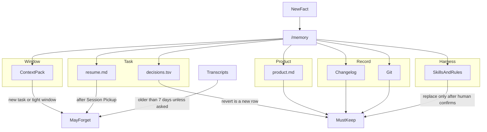

# Memory

`/context` chooses what to read now. This skill chooses what is allowed to survive that reading.

Do not create a `memory.md` or any new store. Write the fact into the store that already owns that lifetime.

## When to use

- `/memory`, "what should I remember", "can I forget this", "where does this go"
- A fact should outlive the current turn
- You are about to copy a transcript, note, or screenshot into a durable file

## How a fact moves

A fact lands in the shortest tier that can hold it.

`/recall` may read transcripts. It does not promote them into `product.md` or the harness.

## Tiers

| Tier | Store | Lasts until | Forget |
|------|--------|-------------|--------|
| Window | Context pack | `new task`, or `/context` drops it because the window is tight | Yes |
| Task | `decisions.tsv` while the work is open. `.cursor/resume.md` after Pause Safely | The task is finished, or Session Pickup has continued from the resume note | Resume note only after pickup. Do not delete decision rows. A revert is a new row. |
| Product | `product.md` | The user changes the product | No. Do not rewrite or delete it. |
| Record | `FSTACK_CHANGELOG.md` or `.fstack/changelog.md`, and git | Kept | No. Append only. A later chat may leave it unread. |
| Harness | Skills and rules via `/reflect` or `/harness-improve` | A later edit replaces them | No, until a human confirms the replacement. |

## Allowed to forget

- The context pack, scratch notes, and temp screenshots once the changelog points at the durable proof
- Transcripts outside the recall window, unless the user asks for them
- A resume note after Session Pickup
- A fact that was only true for the last attempt and is already recorded as reverted

## Not allowed to forget

- Product facts, changelog entries, and decision rows
- A correction the user repeated. That goes to the harness, not into the next chat
- Unsaved edits. Use **Pause Safely** first

## Before writing anything down

Pick one tier. If two stores could hold the fact, use the shorter one.

| Fact | Tier |
|------|------|
| A button color that matches the design system | Task |
| "This product is a billing app for clinic admins" | Product |
| The playbook steps for this turn | Window |
| A merged PR | Record |
| "Agents keep skipping empty states" | Harness, after confirmation |
